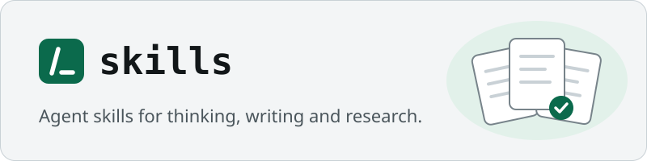

<p align="center">
  
</p>

<p align="center">Small, sharp skills for thinking, writing and research, for Claude Code and any agent that reads <code>SKILL.md</code> folders.</p>

<p align="center">
  <a href="https://github.com/rishabh0111/skills/actions/workflows/check.yml"></a>
  <a href="LICENSE"></a>
  
</p>

> **Quick start:** In Claude Code 2.1.275 or later, run `/plugin install skills-core --marketplace rishabh0111/skills`, then `/sk-ask` to find the skill for what you are doing. If you use software-factory, you already have them.

## Why

Agents slip in the same places whatever the project:

- Asked to help with an idea, the agent starts building before it knows what you want.
- Its prose reads as machine-written: a "not just X, but Y" in every paragraph, dashes everywhere, a one-line closer after each point.
- A research answer cites a blog post that summarises the source, or nothing at all.
- A new session starts from zero because the last one left nothing behind.
- A skill you wrote reads well and then fails the first time an agent runs it under pressure.

These skills cover that ground. Interviews ask one round of numbered questions at a time, each with a recommended answer. Writing follows one catalogue of plain-writing rules. Research goes to primary sources and is saved to a file. Handoffs leave a document a fresh agent can pick up, and new skills are tested against subagents before you rely on them. Every name starts with `sk-`, so none clash with built-in commands or other plugins.

## Skills

<!-- skills:start -->
14 skills: 9 you run by typing their name with a slash, and 5 that apply on their own.

### Not sure which?

| Skill | Say this | You get |
|---|---|---|
| `/sk-ask` | "which skill helps me plan a talk?" | The skill to run next, and why |

### Think

| Skill | Say this | You get |
|---|---|---|
| `/sk-stress-test` | "stress-test my plan to move billing to Stripe" | Every open decision in rounds, each with a recommended answer |
| `/sk-brainstorming` | "I want to build something for my running club" | Questions until the real want is clear, then a written design |
| `sk-discover-intent` | applies on its own when a request is vague | The goal behind the ask, before any work starts |
| `sk-decision-rounds` | applies on its own when decisions are open | The engine behind stress-test: one round of numbered questions at a time |
| `/sk-questionnaire` | "turn this decision into questions for the finance team" | A questionnaire someone else can fill in |

### Write and research

| Skill | Say this | You get |
|---|---|---|
| `sk-research` | "find out what the EU AI Act requires for chatbots" | A cited answer from primary sources, saved to a file |
| `sk-writing` | "proofread this cover letter", or on its own when you write or edit prose | Plain, clear text without machine-sounding tells, or a list of grammar, logic and flow fixes |
| `/sk-explain-plainly` | "wait, explain that again" | The last answer in plain words |
| `/sk-resume` | "tailor my résumé to this job posting" | A scored review with the top fixes, or a tailored résumé with a gap analysis |

### Work with agents

| Skill | Say this | You get |
|---|---|---|
| `/sk-handoff` | "hand this off, the next session will write the tests" | A handoff document a fresh agent can pick up |
| `/sk-teach` | "teach me Kubernetes over the next few weeks" | A teaching workspace with lessons and practice across sessions |
| `sk-writing-for-agents` | applies on its own when you edit a skill or CLAUDE.md | Rules for writing documents an agent reads well |
| `/sk-build-skill` | "make a skill for our release checklist" | A new skill, tested against subagents before you rely on it |
<!-- skills:end -->

## Install

```
/plugin install skills-core --marketplace rishabh0111/skills
```

<details>
<summary>With software-factory</summary>

`sf-core` depends on `skills-core`, so installing software-factory installs these skills with it:

```
/plugin install sf-core --marketplace rishabh0111/software-factory
```

</details>

<details>
<summary>In another agent that reads SKILL.md</summary>

Each skill is a folder under `plugins/skills-core/skills/`. Copy the folders you want into your agent's skills directory, keeping the files beside each `SKILL.md`.

</details>

## Usage

```text
/sk-ask  which skill helps me plan a talk?
/sk-stress-test  my plan to move billing to Stripe
/sk-brainstorming  I want to build something for my running club
find out what the EU AI Act requires for chatbots     # sk-research applies on its own
proofread this cover letter                            # sk-writing applies on its own
/sk-handoff  the next session will write the tests
/sk-build-skill  a skill for our release checklist
```

## How it works

1. Skills that apply on their own load when a request matches their description: a vague ask, an open decision, prose to write, a skill or `CLAUDE.md` to edit.
2. The rest wait until you type their name with a slash. `/sk-ask` reads the catalog and names the one to run.
3. Skills that interview you ask one round of numbered questions, each with a recommended answer, and wait for your reply before the next round.
4. Work that should outlast the session ends in a file: a cited research note, a written design, a handoff document, a teaching workspace.

## Common questions

**Do I need software-factory or agent-factory?**
No. `skills-core` stands alone. The factories build on it: software-factory installs it automatically, and agent-factory uses `/sk-build-skill` when you add a department.

**What runs on its own?**
The skills in the tables above without a leading slash. Everything with a slash waits until you type it.

**Does it work with other agents that read SKILL.md?**
Yes. The skills are plain `SKILL.md` folders with their reference files beside them. The install command is a Claude Code feature; in another agent, copy the folders.

**Does it work on Windows?**
Yes. The visual companion in `sk-brainstorming` starts a local server through a Bash script; on Windows, Git Bash provides it.

**How do updates from upstream work?**
Several skills began as open-source skills by other authors. [UPSTREAM.md](UPSTREAM.md) records the source repository, the commit copied and the paths for each one. `scripts/upstream-diff.sh <path-to-upstream-clone>` lists the upstream commits since then that touch those paths, and fixes are ported by hand.

## Related

- [software-factory](https://github.com/rishabh0111/software-factory): skills that take software from an idea to a reviewed, verified, shipped change. Installs these skills with itself.
- [agent-factory](https://github.com/rishabh0111/agent-factory): specialist agents for company work, one per department.

## Contributing

To add a skill, create `plugins/skills-core/skills/sk-<name>/SKILL.md`; `/sk-build-skill` helps you write and test it. Add a row to `scripts/readme.json` with its group, an example ask and what you get (a skill without a row lands in an "Other" group), then run:

```
node scripts/build-site.mjs
```

That regenerates the `sk-ask` catalog and the skill tables in this README. CI runs `node scripts/build-site.mjs --check` and `claude plugin validate . --strict`, and fails when either is out of date.

## License

[MIT](LICENSE) for this repository's own files. Bundled content keeps its own licence, which sits beside it: in the plugin folder, or in a skill's own folder when it differs. [UPSTREAM.md](UPSTREAM.md) lists the source of every skill.
